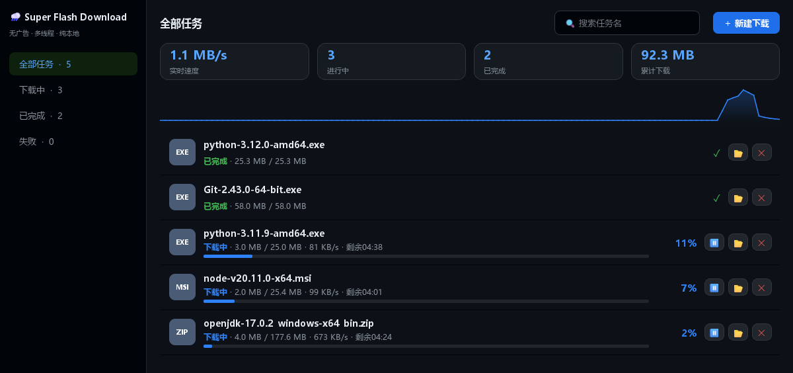

# Super Flash Download · 高速多线程下载器

[](LICENSE)
[](https://www.python.org/)
[](#安装)
[](https://github.com/jameszwb/super-flash-download/releases/latest)
[](https://github.com/jameszwb/super-flash-download/stargazers)



Windows 平台的多线程下载工具。引擎纯 Python 标准库实现（零第三方依赖），
GUI 用 PySide6，并内置本机 REST API —— 脚本或 AI 助手可以直接驱动界面。

**[⬇ 直接下载单文件 exe](https://github.com/jameszwb/super-flash-download/releases/latest)** —— 不需要装 Python。也可从源码跑：`pip install PySide6 && python xygui.py`。

> 模块文件名里的 `xy` 是历史内部代号，产品名是 **Super Flash Download**。
> 保留该前缀是为了不动 import 关系与提交历史。

---

## 为什么做这个

大部分桌面下载器要么捆一个浏览器内核、要么强制联网校验、要么把引擎藏在闭源二进制里。
这个项目的引擎约 760 行，一下午能读完：

- **work-stealing 分片**：快线程自动偷慢线程的活，8MB 主块 + 256KB 尾块，
  不让最后一块被单线程独占后卡在 98%。
- **记账铁律**：`steal()` 只发任务不记账，`commit()` 在字节真正落盘后才计数。
  这是"报 100% 但文件是空的"这类 bug 的根治法。
- **精确续传**：`.sfd` 状态文件记录已完成区间 + 在途游标，强杀进程后按字节接着下。
- **连接器**：`xyc.py` 驱动 GUI 的本机 API（`127.0.0.1:16901`），
  curl、shell 脚本、LLM agent 都能推任务。

---

## 特性

| 模块 | 能力 |
|---|---|
| 引擎 | work-stealing 动态分片、keep-alive 连接池、字节级断点续传 |
| 多源 | 同一文件给多个镜像，自动探测（大小一致 + 支持 Range）、剔除坏源、线程轮换 |
| 代理 | 每个 worker 真正走 HTTPS `CONNECT` 隧道（不只是探测请求），支持 `user:pass` |
| 文件名 | 优先解析 RFC 5987 `filename*=UTF-8''…`，服务器声明的真名优先于 URL 末段 |
| 重定向 | 手动跟 301/302/303/307/308，保留 `Range` 头，跳转不会让分片重来 |
| BT | 磁力链 / `.torrent`，走 libtorrent，与 HTTP 任务同一套交互 |
| 限速 | 1MB/s ~ 不限速五档 |
| 单实例 | Windows 命名互斥体，第二个实例退出码 3 并唤出已有窗口 |

---

## 和同类工具比

如果正在 aria2、IDM、Motrix、FDM 之间选，真正有差别的是这几项：

| | **Super Flash Download** | aria2 | IDM | Motrix |
|---|---|---|---|---|
| **GUI** | ✔ PySide6 原生 | ✘ 只有命令行（有第三方壳） | ✔ | ✔ Electron |
| **开源** | ✔ MIT | ✔ GPL-2.0 | ✘ 闭源收费 | ✔ MIT |
| **广告 / 账号 / 遥测** | 全无 | 全无 | 需要激活，闭源 | 全无 |
| **引擎可读** | ✔ ~760 行纯标准库 | ✔ C++，体量大 | ✘ 二进制 | 内置 aria2 |
| **本机 REST API（脚本 / AI 直驱）** | ✔ `127.0.0.1:16901` | ✔ JSON-RPC | ✘ | ✘ |
| **强杀后续传（字节级）** | ✔ `.sfd` 区间日志 | ✔ | ✔ | ✔ |
| **BT / 磁力** | ✔ 可选 | ✔ | ✘ | ✔ |
| **体积** | 引擎零依赖 | ~10 MB | 闭源安装包 | ~100 MB Electron |
| **平台** | Windows 10/11 | 跨平台 | Windows | 跨平台 |

一句话：aria2 的引擎 + 正经桌面界面，IDM 的续传语义但不要激活码，
再加一个 HTTP API —— 让 agent 去排队下载，而不是你自己点。

---

## 适合谁用

- 要一个 Windows 上带界面的**多线程下载器**，不要广告、不要账号、不要后台偷偷联网校验。
- 下载要能被脚本驱动，想要一个**本机 REST API**（curl / Python / LLM agent），
  而不是用浏览器自动化去点按钮。
- 想先把引擎**读完**再让它下载 20 GB 的东西，出问题能自己改。

对应的搜索词（这个项目确实解决的问题）：多线程下载器、aria2 界面、IDM 替代、
断点续传下载、磁力链接下载、Windows 免安装下载器、下载管理器 REST API。

---

## 安装

```bash
git clone https://github.com/jameszwb/super-flash-download.git
cd super-flash-download

# 引擎与 CLI：无需安装任何东西
python xyengine.py --help

# GUI
pip install PySide6
python xygui.py

# 可选：BT / 磁力（需 Python 3.13，libtorrent 只发该版本轮子）
pip install libtorrent
```

引擎支持 Python 3.10+，BT 与 GUI 需要 3.13。

---

## 用法

### 引擎 CLI

```bash
# 16 线程 + 限速 5MB/s
python xyengine.py https://example.com/file.zip -n 16 --limit 5242880

# 多镜像加速
python xyengine.py https://mirror-a/file.zip \
    --mirror https://mirror-b/file.zip \
    --mirror https://mirror-c/file.zip

# 走 HTTP 代理
python xyengine.py https://example.com/file.zip --proxy http://127.0.0.1:7890
```

### 连接器（用脚本驱动 GUI）

```bash
python xyc.py add <url> -o D:\Downloads   # 推任务（http / magnet / .torrent）
python xyc.py list                        # 实时列表
python xyc.py info <任务ID>                # 单任务详情
python xyc.py pause|resume <任务ID|all>
python xyc.py delete <任务ID|all> [--with-file]
python xyc.py health                      # GUI 是否在线
```

GUI 没开时 `xyc.py` 会自动拉起并轮询 API 就绪，不需要手动点图标。

### 单文件版

```bash
python xy.py <url>                          # 默认 8 线程 / 32MB 分片
python xy.py <url> -n 16 -s 4               # 16 线程，每片 4MB
python xy.py list.txt                       # 批量，每行一个 URL
```

---

## 架构

| 文件 | 职责 | 行数 |
|---|---|---|
| `xyengine.py` | work-stealing 引擎、`BlockQueue` 记账、probe、续传状态 | ~760 |
| `xygui.py` | PySide6 界面 + 内嵌 REST API | ~1,230 |
| `xyc.py` | 连接器 CLI | ~240 |
| `xybt.py` | libtorrent 后端，接口对齐 HTTP `Task` | ~175 |
| `xy.py` | 单文件下载器（无 GUI、无依赖） | ~240 |

---

## 实测数据

Windows 11、家用光纤，项目历史真实记录：

| 场景 | 结果 |
|---|---|
| Node.js zip 28.3MB / 16 线程 | sha256 与官方 `SHASUMS256.txt` 一致 |
| 同文件单连接 | 分片提速 **6.5×** |
| 1MB 块 16 线程 | 6.0 MB/s |
| 8MB 块 4 线程 | **21.2 MB/s** —— 块大小比线程数更决定速度 |
| HTTP 代理 33.6MB | 隧道修复前 394 KB/s → 修复后 **6.6 MB/s** |
| 镜像池 356MB | 约 10 秒（~17.9 MB/s） |
| 暂停 → 恢复 | 暂停期间净增 0 字节；恢复后 sha256 完整 |
| BT Sintel 123MB | FINISHED，握手后 19KB/s → 1.1MB/s |

---

## 已知限制

- **以 Windows 为主**。引擎可移植，但 GUI、命名互斥体、快捷启动流程是 Windows 专属。
- **服务端不支持 Range → 退化为单线程且无法续传**，这是协议限制。
- **不支持 ED2K / `thunder://`**，后者只能拉起第三方客户端。
- **`.sfd` 状态文件不跨文件大小复用**：远端文件大小变了就丢弃状态，避免拼出坏文件。
- **BT 与 GUI 必须 Python 3.13**，libtorrent 的轮子不覆盖所有版本。

---

## 许可证

MIT，见 [LICENSE](LICENSE)。